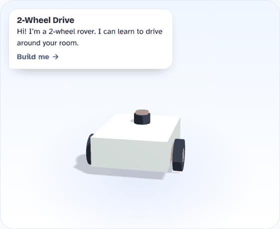
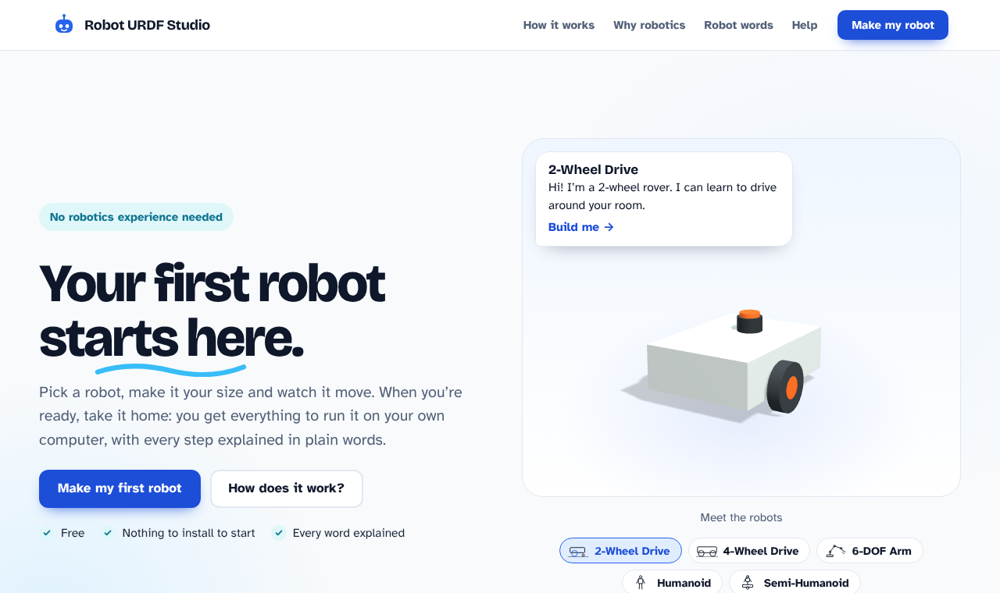
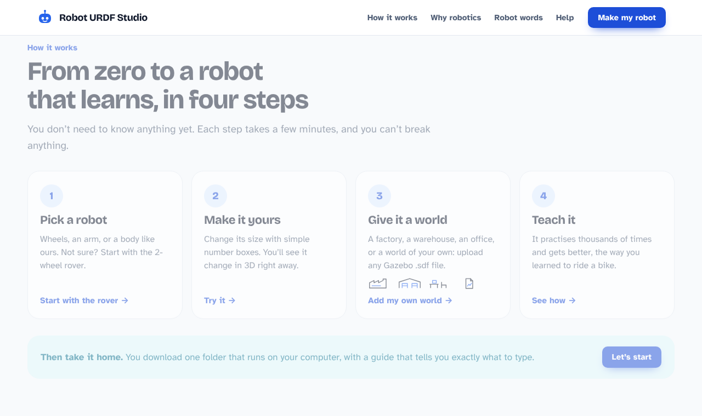
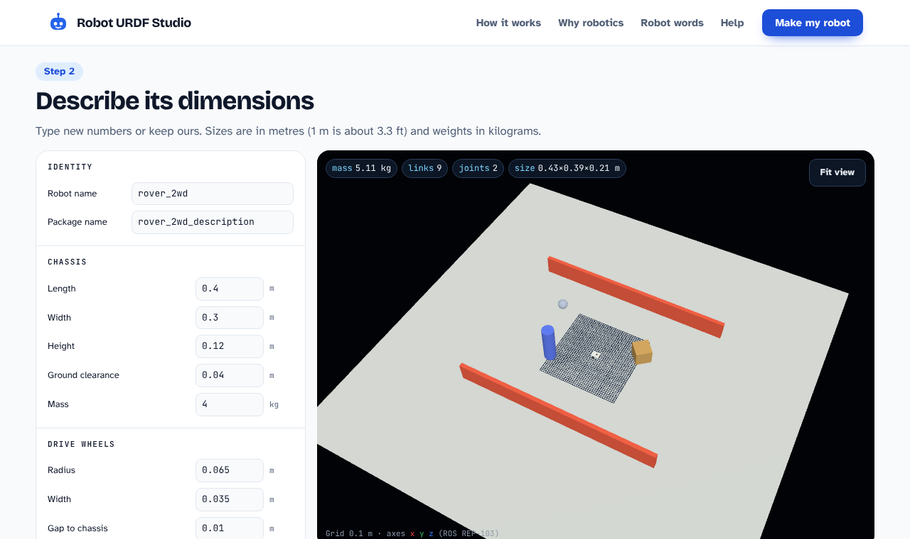
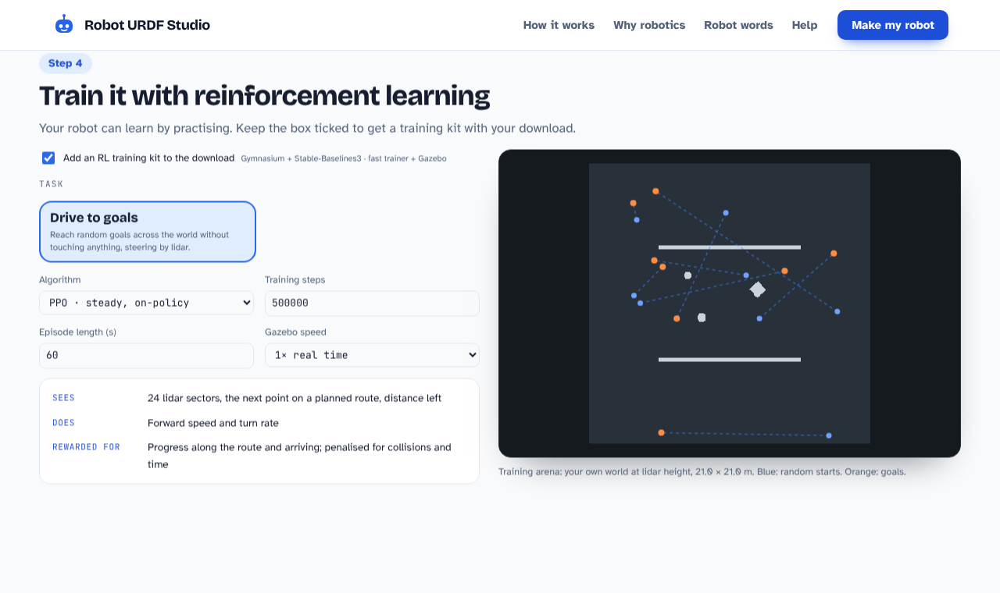
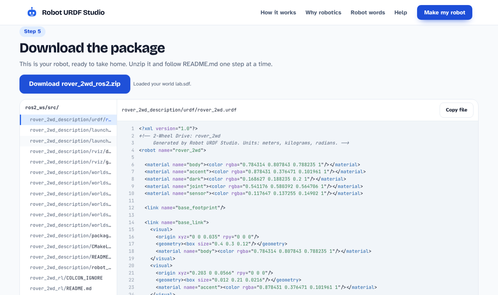

# Robot URDF Studio

**Your first robot starts here.**
Design a robot in your browser, drop it into a world, teach it to drive by itself, and download a ROS 2 package that runs in Gazebo.

### [▶ Try it live — free, no install](https://robot-urdf-studio.vercel.app)

---

## No robotics experience needed

Pick a robot, change its size with simple number boxes, and watch it move in 3D. Every robot word is explained in plain language, and every download comes with a step-by-step guide and commands you can copy.

## How it works

| | Step | What you do |
|---|---|---|
| 1 | **Pick a robot** | 2-wheel rover, 4-wheel rover, 6-axis robot arm, humanoid or semi-humanoid |
| 2 | **Make it yours** | Set sizes and weights; the 3D model updates instantly |
| 3 | **Give it a world** | Factory, warehouse, office, or **upload your own Gazebo `.sdf` world** |
| 4 | **Teach it** | Add a reinforcement learning kit: the robot practises and learns by itself |
| 5 | **Take it home** | Download one zip that builds with `colcon` and runs in RViz and Gazebo |

## Bring your own world

Upload any Gazebo world (`.sdf` / `.world`, or a `.zip` with its models and meshes). The studio previews it, prepares it so your robot runs in it straight away, and lets you choose where the robot starts.

## Robots that teach themselves

Tick one box and your download includes a training kit. Train in minutes on a laptop, then watch the robot drive to goals in Gazebo, avoiding everything in your world.

## What's in the download

- Robot blueprint (URDF) with real masses and inertia, colours, sensors (lidar, camera, IMU)
- Launch files for **RViz** and **Gazebo** (ROS 2 Jazzy + Harmonic, or Humble + Fortress)
- **MoveIt 2** setup for arms and humanoids: motion planning, inverse kinematics, controllers
- Ready-made worlds, plus your own uploaded world
- A **reinforcement learning kit** (Gymnasium + Stable-Baselines3) with a fast trainer and a Gazebo trainer

---

**Every robotics engineer started with a first robot. Make yours today.**

### [▶ Open Robot URDF Studio](https://robot-urdf-studio.vercel.app)

